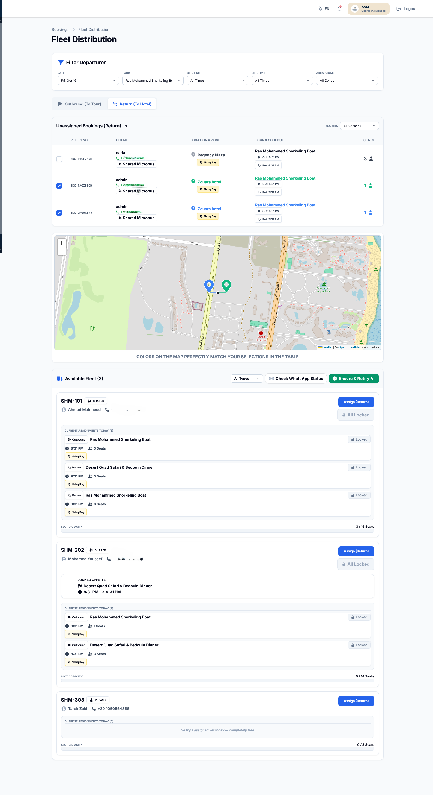
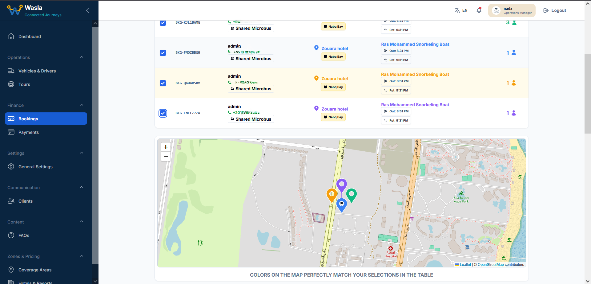
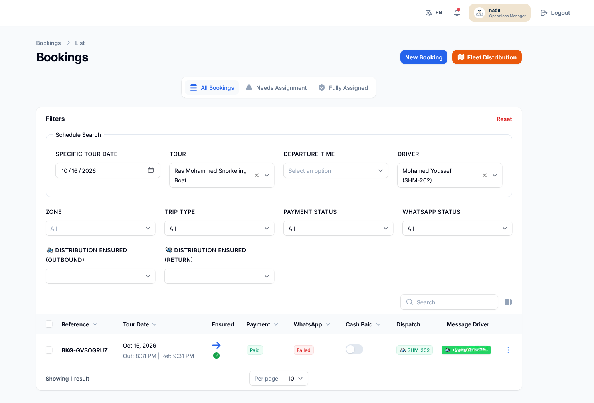
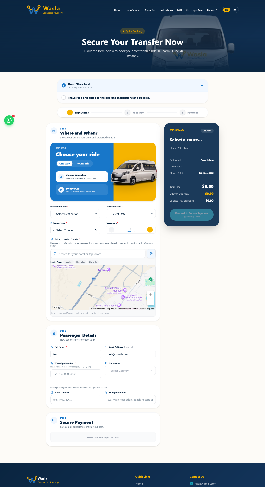

# 🚐 Wasla - Tourist Transportation & Fleet Management CMS

**Wasla** is a comprehensive, enterprise-level Tourist Booking Platform and Fleet Management System. It provides a seamless front-end booking experience for tourists and a powerful, smart Admin Dashboard (CMS) for operations and fleet management.

## 🛠️ Tech Stack & Technologies
- **Backend:** Laravel 11, PHP
- **Admin Panel:** Filament PHP (TALL Stack)
- **Frontend:** Alpine.js, Tailwind CSS, Livewire
- **Database:** MySQL
- **Integrations:**
  - **Maps & Geolocation:** Google Maps API / OpenStreetMap
  - **Payments:** Kashier Payment Gateway
  - **Messaging:** WhatsApp Integration (Green API)

## 📸 Screenshots

| Front-End Experience | Admin Dashboard (CMS) |
| :---: | :---: |
|  <br> *Landing Page* |  <br> *Stats & Operations Dashboard* |
|  <br> *Smart Booking Engine* |  <br> *Smart Fleet Distribution (Map-Assisted)* |
|  <br> *Zones & Hotels Map* |  <br> *Tours & Pricing Management* |
|  <br> *Checkout & Payment* |  <br> *Driver WhatsApp Manifest* |

## ✨ Key Features
- **Smart Fleet Distribution:** Map-assisted interface for admins to assign vehicles to bookings based on location and capacity.
- **Automated WhatsApp Notifications:** Instant booking confirmations for clients and driver manifests via Green API.
- **Dynamic Pricing Engine:** Support for base prices, specific offers, and auto-calculating "Cash Due on Board".
- **Booking Lock System:** Ensures data integrity by locking records once a driver is assigned.
- **Multi-language Support:** Front-end (English/Russian) and Admin Panel (English/Arabic).
- **Hotels Database:** Pre-configured with 260+ hotels mapped to specific geographic zones.

## 🚀 Installation & Setup

1. **Clone the repository:**
   ```bash
   git clone [https://github.com/your-username/wasla.git](https://github.com/your-username/wasla.git)
   cd wasla

   Install dependencies:
    Bash

    composer install
    npm install

    Environment Setup:
    Copy the .env.example file and configure your database and API keys:
    Bash

    cp .env.example .env
    php artisan key:generate
    php artisan storage:link

    Database Migration & Seeding:
    Bash

    php artisan optimize:clear
    php artisan migrate --seed

    (Optional) Fetch Hotels Data:
    Bash

    php artisan hotels:fetch-osm

💻 Running Locally

To run the application locally, you will need to start several processes in separate terminal tabs:
Bash

# Tab 1: Start Laravel server
php artisan serve

# Tab 2: Compile frontend assets
npm run dev

# Tab 3: Process background jobs (Emails, WhatsApp)
php artisan queue:work

# Tab 4: Run scheduled tasks (Auto-cleanup, etc.)
php artisan schedule:work

🛡️ Admin Access

Once the database is seeded, you can log in to the admin panel at http://your-local-domain/admin using the default credentials:

    Email: admin@gmail.com

    Password: 12345678
