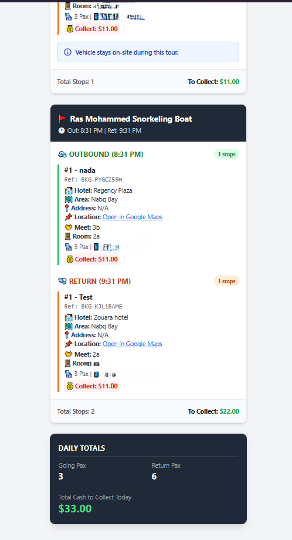
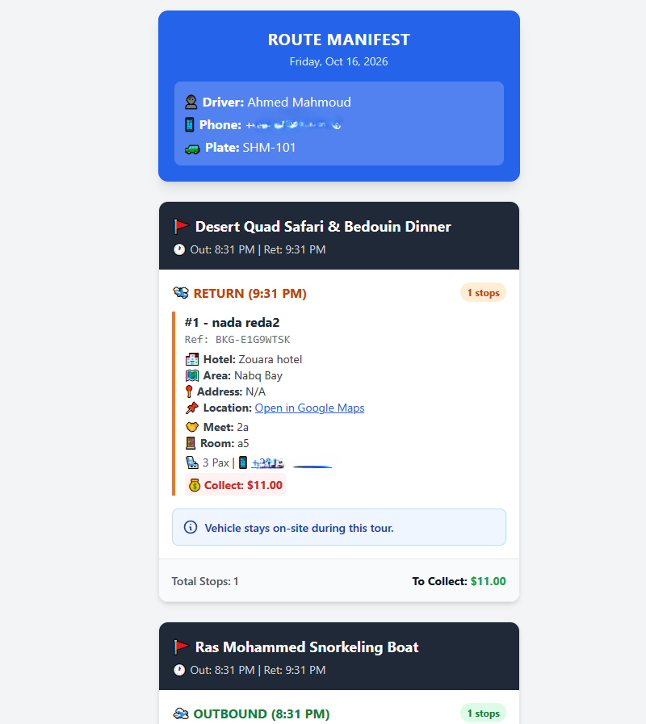
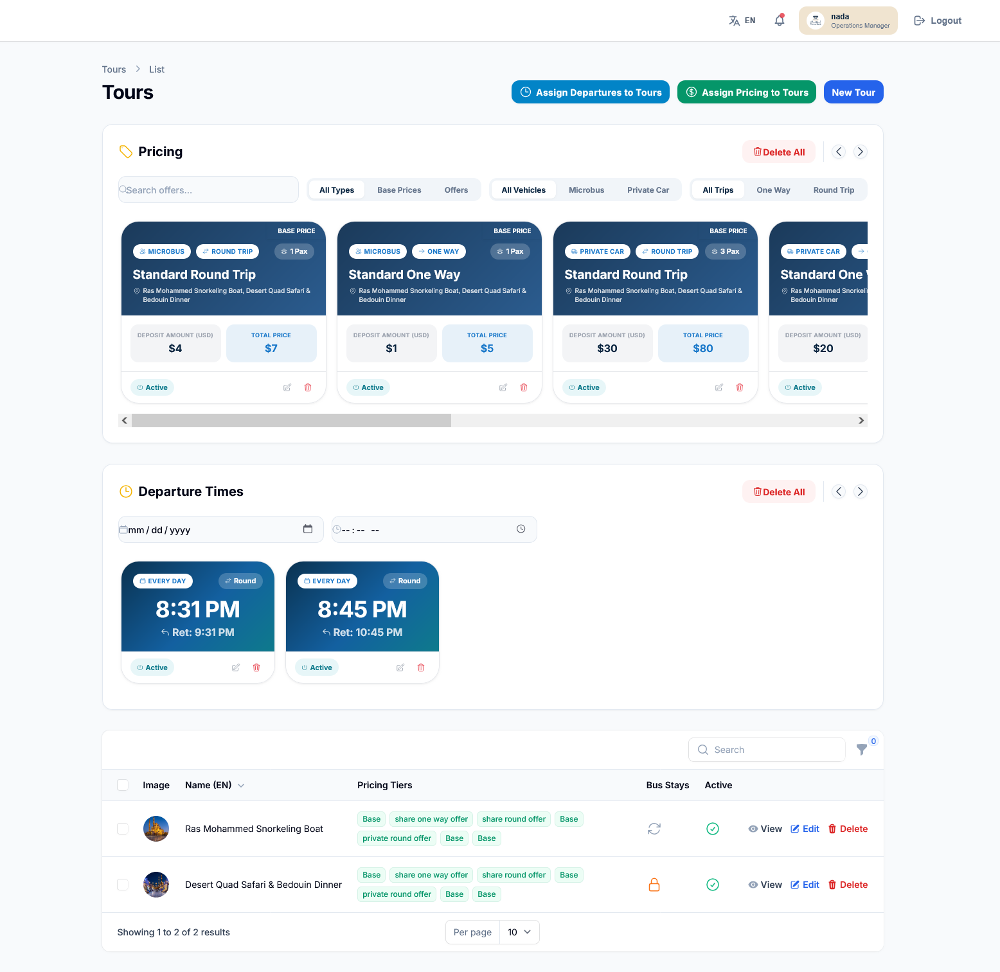
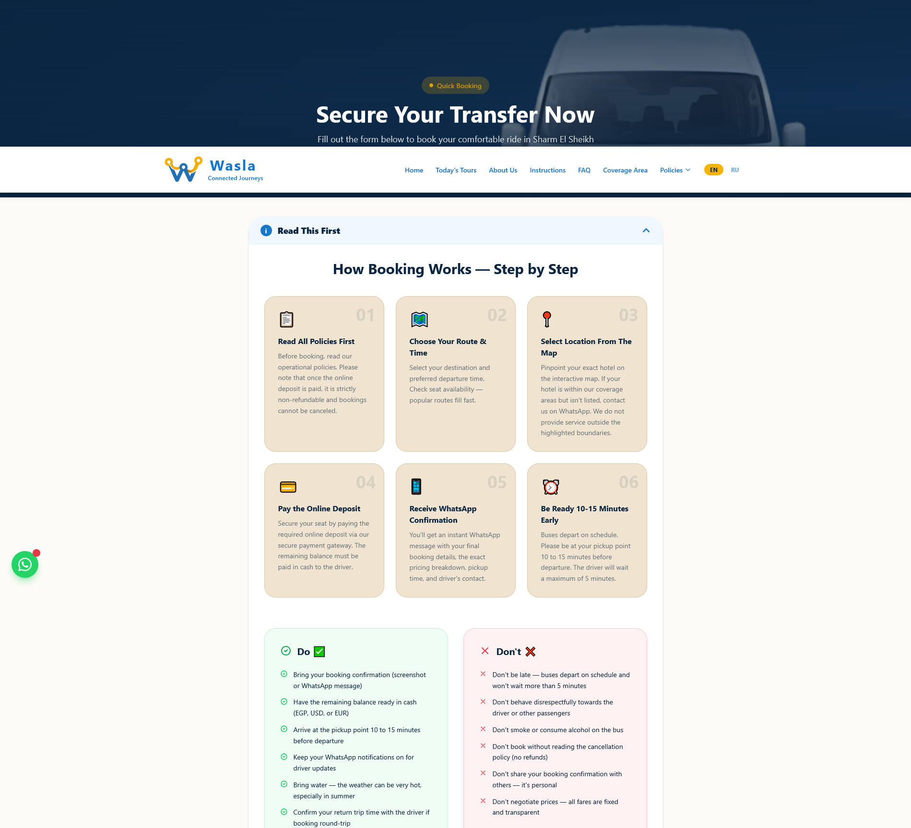

# 🚐 Wasla - Tourist Transportation & Fleet Management CMS

**Wasla** is a comprehensive, enterprise-level Tourist Booking Platform and Fleet Management System. It provides a seamless front-end booking experience for tourists and a powerful, smart Admin Dashboard (CMS) for operations and fleet management.

## 🛠️ Tech Stack & Technologies
- **Backend:** Laravel 11, PHP
- **Admin Panel:** Filament PHP (TALL Stack)
- **Frontend:** Alpine.js, Tailwind CSS, Livewire
- **Database:** MySQL
- **Integrations:**
  - **Maps & Geolocation:** Google Maps API / OpenStreetMap
  - **Payments:** Kashier Payment Gateway
  - **Messaging:** WhatsApp Integration (Green API)

## 📸 Screenshots

| Booking/Booking Distribution | Frontend & Manifests |
| :---: | :---: |
|  <br> *Booking Distribution* |  <br> *Booking Form* |
|  <br> *Visual Map Distribution* |  <br> *Driver WhatsApp Manifest* |
|  <br> *Zones & Hotels Map* |  <br> *Daily Driver WhatsApp Manifest* |
|  <br> *Tours, Prcing, Departures Mangement* |  <br> *Booking Form Instructions* |

## ✨ Key Features
- **Smart Fleet Distribution:** Map-assisted interface for admins to assign vehicles to bookings based on location and capacity.
- **Automated WhatsApp Notifications:** Instant booking confirmations for clients and driver manifests via Green API.
- **Dynamic Pricing Engine:** Support for base prices, specific offers, and auto-calculating "Cash Due on Board".
- **Booking Lock System:** Ensures data integrity by locking records once a driver is assigned.
- **Multi-language Support:** Front-end (English/Russian) and Admin Panel (English/Arabic).
- **Hotels Database:** Pre-configured with 260+ hotels mapped to specific geographic zones.

## 🚀 Installation & Setup

1. **Clone the repository:**
  ```bash
# 1. Clone the repository
git clone [https://github.com/NadaReda22/Wasla.git](https://github.com/NadaReda22/Wasla.git)
cd wasla

# 2. Install dependencies
composer install
npm install

# 3. Environment Setup (Configure your database and API keys in .env)
cp .env.example .env
php artisan key:generate
php artisan storage:link

# 4. Database Migration & Seeding
php artisan optimize:clear
php artisan migrate --seed

# 5. (Optional) Fetch Hotels Data
php artisan hotels:fetch-osm

# ==========================================
# 💻 Running Locally
# Open separate terminal tabs for the following:
# ==========================================

# Tab 1: Start Laravel server
php artisan serve

# Tab 2: Compile frontend assets
npm run dev

# Tab 3: Process background jobs (Emails, WhatsApp)
php artisan queue:work

# Tab 4: Run scheduled tasks (Auto-cleanup, etc.)
php artisan schedule:work

🛡️ Admin Access

Once the database is seeded, you can log in to the admin panel at http://your-local-domain/admin using the default credentials:

    Email: admin@gmail.com

    Password: 12345678
